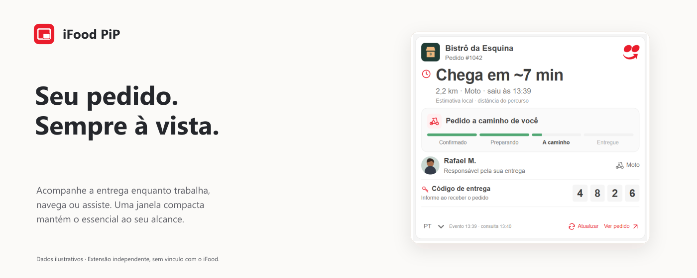
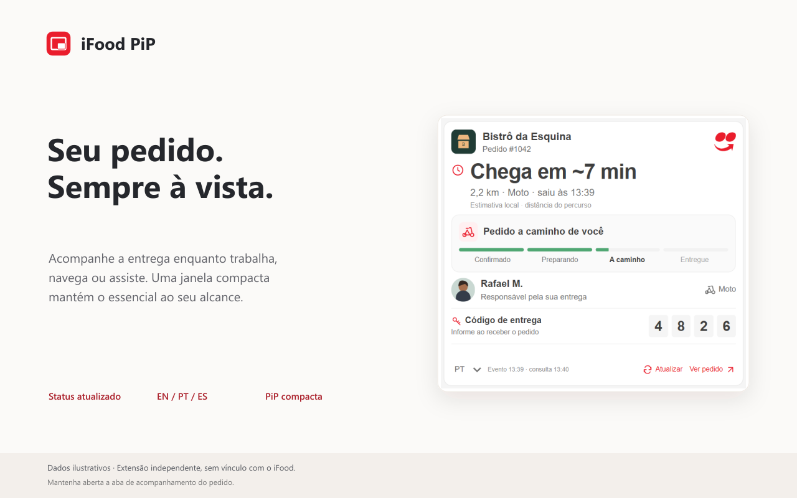
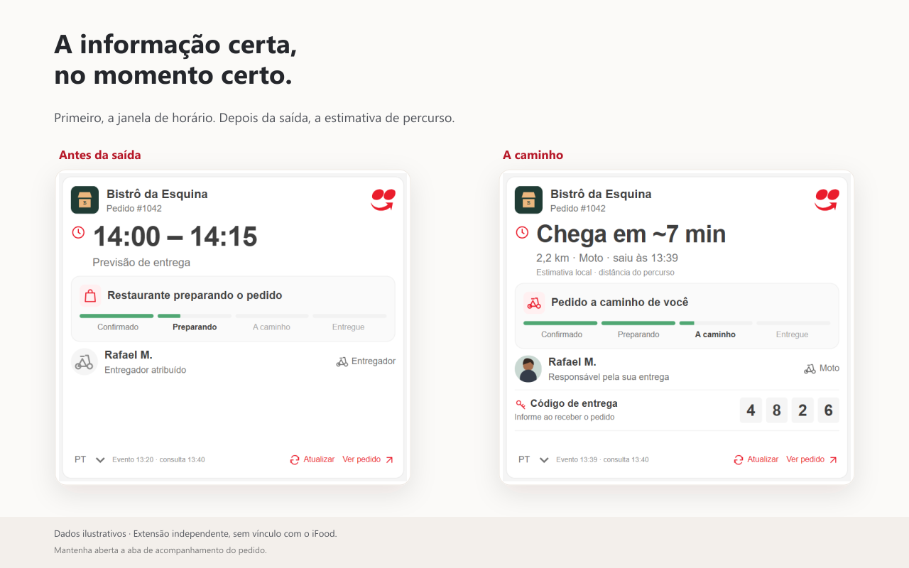

  

  # iFood PiP

  **Seu pedido em uma janela flutuante. Seu computador continua livre.**

  Acompanhe o iFood enquanto trabalha, estuda, navega ou usa outros aplicativos — sem precisar manter a aba do pedido em primeiro plano.

  **Versão 0.0.6** · **Manifest V3** · **Apache 2.0**

  
  
    
   

---

## O problema que resolve

Acompanhar uma entrega pelo navegador não deveria exigir que você fique preso à página do pedido. Com o **iFood PiP**, o acompanhamento fica em uma pequena janela independente, que pode permanecer visível sobre outros aplicativos e atualizar as informações sem que você precise voltar à aba do iFood a todo momento.

## Funcionalidades

- **Janela flutuante de verdade:** utiliza a API *Document Picture-in-Picture* para mostrar o acompanhamento fora da aba original, inclusive sobre outros programas.
- **Atualizações automáticas:** reaproveita as consultas autenticadas que o próprio site do iFood faz para verificar os eventos do pedido enquanto a mini janela está aberta.
- **Informações em um só lugar:** mostra etapas do pedido e, quando disponíveis, dados da loja, do entregador, do veículo e da entrega.
- **Previsão de chegada:** apresenta a faixa de entrega informada pelo iFood e, após a saída para entrega, pode calcular uma **estimativa local aproximada** usando os dados disponíveis.
- **Previsão por etapa:** antes da saída, mantém a faixa completa da loja (por exemplo, `13:30 – 14:00`) nos dois modos. A contagem `~8 min` começa no horário da saída para entrega; atribuição do entregador e retirada na loja não iniciam o relógio.
- **Privacidade por padrão:** não tem servidor do desenvolvedor, anúncios nem ferramentas de análise; os dados do pedido não são enviados a um serviço externo do projeto.
- **Três idiomas:** português, inglês e espanhol, com seleção diretamente na mini janela.
- **Dois modos:** acompanhamento completo ou compacto, com status e chegada em destaque. O controle no canto superior alterna os modos e salva a escolha para a próxima abertura.

## Prévia

| Acompanhamento | Progresso da entrega |
|:---:|:---:|
|  |  |

## Instalação

### Pelo código-fonte (Edge ou Chrome)

1. Baixe este repositório como ZIP e extraia os arquivos, ou clone o repositório.
2. Acesse `edge://extensions` no Microsoft Edge ou `chrome://extensions` no Google Chrome.
3. Ative o **Modo do desenvolvedor**.
4. Clique em **Carregar sem compactação** e selecione a pasta que contém o `manifest.json`.
5. Abra a página de acompanhamento de um pedido no iFood e, se necessário, recarregue a aba.
6. Aguarde o carregamento das informações e clique em **Mini janela do pedido**.

**Requisitos:** navegador compatível com *Document Picture-in-Picture* (Chrome 116+ ou versão compatível do Edge), acesso a uma conta do iFood e um pedido com página de acompanhamento disponível.

## Como funciona

A extensão é inicializada em `https://www.ifood.com.br/*` para acompanhar a navegação interna do site. O botão e a mini janela ficam disponíveis **somente nas páginas de acompanhamento de pedido**. Assim, entrar pelo início do iFood e abrir um pedido não exige atualizar a página.

Ela observa as requisições feitas pela própria página para obter os eventos do pedido. Com a mini janela aberta, pode repetir essas consultas diretamente ao iFood, utilizando a sessão já autenticada no navegador. A interface é atualizada conforme os dados recebidos.

A janela usa a API *Document Picture-in-Picture* do navegador. Isso permite acompanhar o pedido enquanto você utiliza outras abas **ou outros aplicativos**, sem deixar a página de rastreamento visível na tela.

> **Importante:** a aba original do pedido precisa continuar **aberta**, mas pode ficar em segundo plano. Fechar ou recarregar essa aba também encerra a mini janela. A previsão calculada pela extensão é uma aproximação, não uma estimativa oficial de trânsito em tempo real.

## Privacidade

O iFood PiP foi pensado para funcionar sem coleta de dados pelo desenvolvedor:

- Não solicita login, senha ou token fora da autenticação normal do iFood.
- Mantém as informações do pedido e os dados de autenticação observados **em memória** durante o uso.
- Comunica-se com os serviços do próprio iFood e com os endereços de imagens necessários para exibir o acompanhamento; **não envia dados do pedido para servidores do desenvolvedor**.
- Armazena localmente as preferências de idioma (`ifood-pip-language`) e visualização (`ifood-pip-mode`).
- Não inclui rastreadores, anúncios ou telemetria do projeto.

Leia também a [Política de Privacidade](PRIVACY.md).

## Contribuições

Sugestões, correções e melhorias são bem-vindas. Você pode abrir uma *issue* para relatar um problema ou enviar um *pull request* com uma proposta de alteração.

Para usar o código deste repositório, carregue a pasta como extensão descompactada. O `content.js` gerado está incluído; não é necessário instalar dependências para usar a extensão.

Para desenvolver, use Node.js 20+ e execute `npm run build`, `npm test` e `npm run check`. Não há pacotes a instalar. Edite `src/`, os estilos e `_locales/`, gere novamente o pacote, recarregue a extensão e a aba do pedido. Consulte [ARCHITECTURE.md](ARCHITECTURE.md) para organização, traduções e testes de navegador.

## Licença

Este projeto é disponibilizado como software de código aberto sob a **[Apache License 2.0](LICENSE)**. Consulte o arquivo `LICENSE` para os termos completos.

## Aviso

**iFood PiP é um projeto independente.** Não é desenvolvido, mantido, patrocinado ou endossado pelo iFood. A marca iFood pertence aos seus respectivos titulares. A licença deste repositório não concede direitos sobre marcas de terceiros.

---

  Feito para você acompanhar a entrega sem interromper o que está fazendo.

