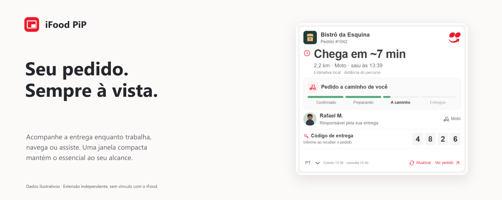
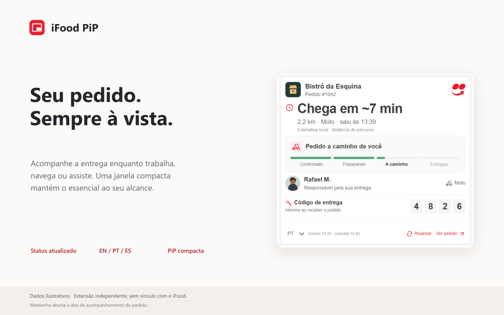
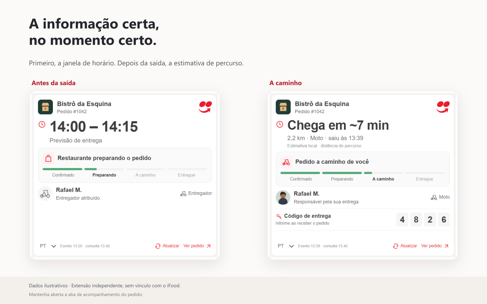

<div align="center">
  

  # iFood PiP

  **Acompanhe seu pedido em uma janela flutuante. Continue usando o computador normalmente.**

  Uma extensão para acompanhar entregas do iFood enquanto você trabalha, estuda ou navega — sem manter a página do pedido em primeiro plano.

  **v0.0.9** · Manifest V3 · Chrome & Edge · Português, English, Español · Apache 2.0

  <h3>Instale pela loja do seu navegador</h3>
</div>

<div align="center">
  <table align="center">
    <thead>
      <tr>
        <th align="center">Google Chrome</th>
        <th align="center">Microsoft Edge</th>
      </tr>
    </thead>
    <tbody>
      <tr>
        <td align="center">
          <a href="https://chromewebstore.google.com/detail/ifood-pip-%E2%80%94-pedido-em-min/gkmphecdhlchhmdjfmpjlomoiflhhjbj"></a>
        </td>
        <td align="center">
          <a href="https://microsoftedge.microsoft.com/addons/detail/hndpmofimdbajogjfnpjeamiolhipiia"></a>
        </td>
      </tr>
      <tr>
        <td align="center"><a href="https://chromewebstore.google.com/detail/ifood-pip-%E2%80%94-pedido-em-min/gkmphecdhlchhmdjfmpjlomoiflhhjbj"><strong>Instalar pela Chrome Web Store</strong></a></td>
        <td align="center"><a href="https://microsoftedge.microsoft.com/addons/detail/hndpmofimdbajogjfnpjeamiolhipiia"><strong>Instalar pelo Microsoft Edge Add-ons</strong></a></td>
      </tr>
    </tbody>
  </table>
  <sub>Imagens das lojas hospedadas neste repositório — nenhum logo depende de um servidor externo.</sub>
</div>

---



## Seu pedido à vista, sem interromper o que você está fazendo

O **iFood PiP** transforma o acompanhamento do pedido em uma janela independente, usando a API **Document Picture-in-Picture**. Você pode continuar em outras abas e até em outros aplicativos enquanto acompanha as etapas da entrega.

A aba original do pedido permanece aberta em segundo plano; você não precisa deixá-la visível.

## O que a extensão oferece

- **Janela sempre à mão:** visualização flutuante com modos **recolhido** e **expandido**. A janela sempre abre recolhida; você pode expandi-la para consultar mais detalhes.
- **Acompanhamento atualizado:** eventos observados na própria página do iFood são refletidos na interface. Com a mini janela aberta, a extensão pode consultar o iFood automaticamente a cada **60 segundos** ou quando você clicar em **Atualizar**.
- **Etapas do pedido:** progresso da preparação à entrega, com informações do estabelecimento, horários e situação atual.
- **Detalhes quando disponíveis:** dados do entregador, veículo, distância, percurso e código de entrega aparecem conforme são fornecidos pelo iFood.
- **Estimativa de chegada:** preserva a faixa de entrega informada pelo iFood e, após a **saída para entrega**, pode mostrar uma contagem aproximada calculada localmente. A previsão própria não é uma estimativa oficial de trânsito.
- **Interface em três idiomas:** português, inglês e espanhol, com escolha dentro da mini janela.
- **Recuperação de falhas:** após quatro consultas malsucedidas consecutivas, pausa as atualizações independentes e orienta a atualizar a página do pedido. Pedidos concluídos ou cancelados encerram essas consultas.
- **Privacidade:** sem servidor do desenvolvedor, anúncios ou ferramentas de telemetria. Os dados de acompanhamento não são enviados para a infraestrutura do projeto.

## Veja como fica

| Acompanhamento do pedido | Detalhes da entrega |
|:---:|:---:|
|  |  |

<sub>Imagens ilustrativas de divulgação. Para informações sobre os layouts e os testes da versão atual, veja [VALIDATION.md](tests/VALIDATION.md).</sub>

## Como instalar e usar

### Instalação recomendada: lojas oficiais

Use o link da loja correspondente ao seu navegador, no início deste README. Depois de instalar:

1. Entre em [ifood.com.br](https://www.ifood.com.br/) e abra a página de acompanhamento de um pedido.
2. Clique em **Mini janela do pedido** quando o botão aparecer.
3. Continue usando outras abas ou aplicativos. Expanda a janela se quiser ver mais detalhes.
4. Mantenha a **aba original do pedido aberta**, mesmo em segundo plano.

O botão é exibido apenas nas páginas de acompanhamento de pedidos. A extensão reconhece a navegação interna do iFood sem exigir que você atualize a página a cada mudança.

### Instalação manual pelo ZIP

Se preferir instalar a versão de distribuição manualmente:

1. Baixe o [pacote v0.0.9](releases/ifood-pip-0.0.9-chrome-web-store.zip) e extraia o conteúdo.
2. Abra `chrome://extensions` no Chrome ou `edge://extensions` no Edge.
3. Ative o **Modo do desenvolvedor**.
4. Escolha **Carregar sem compactação** e selecione a pasta extraída que contém o `manifest.json`.
5. Abra o acompanhamento de um pedido no iFood.

Se a aba do iFood já estava aberta quando você instalou ou atualizou manualmente a extensão, recarregue-a uma vez para carregar o script novo.

**Requisitos:** Google Chrome 116+ ou versão compatível do Microsoft Edge com suporte a *Document Picture-in-Picture*, uma conta do iFood e um pedido com acompanhamento disponível.

A versão `0.0.9` também está documentada nas [notas de lançamento](releases/NOTES-0.0.9.md) e na [release do GitHub](https://github.com/luannsr12/ifood-pip/releases/tag/0.0.9).

## Como funciona

A extensão usa um *content script* do Manifest V3 no domínio `www.ifood.com.br` para identificar a página de acompanhamento e observar as respostas de pedidos que o próprio site recebe.

Quando a mini janela está aberta, ela pode repetir consultas aos **serviços do próprio iFood**, aproveitando a sessão já autenticada. Novas respostas do site também atualizam a janela, e consultas recentes evitam requisições redundantes.

A mini janela é vinculada à aba original: **fechar ou recarregar essa aba encerra a PiP**. Ao fechar a mini janela, as consultas periódicas independentes da extensão param.

A extensão não pede permissões adicionais no `manifest.json`. Para saber quais informações são processadas e como são mantidas temporariamente, leia a [Política de Privacidade](PRIVACY.md).

## Desenvolvimento

O código-fonte está disponível integralmente neste repositório. O `content.js` compilado já está incluído: não é necessário instalar dependências para **usar** a extensão.

Para **desenvolver**, utilize Node.js 20+ e os comandos:

```bash
npm run build
npm test
npm run check
```

Não há dependências de npm a instalar. Altere os arquivos de `src/`, os estilos ou os catálogos de `_locales/` e gere novamente o `content.js`.

Para experimentar sem pedidos reais, o projeto inclui um simulador com dados fictícios:

```bash
npm run simulate:realtime
```

Esse comando requer Playwright para abrir o cenário no Edge e reproduzir eventos ao longo do tempo; o simulador **não faz parte do pacote publicado**.

**Documentação:** [Arquitetura](ARCHITECTURE.md) · [Testes e simulação](tests/README.md) · [Validação da versão](tests/VALIDATION.md) · [Pacotes de distribuição](releases/README.md).

## Privacidade e transparência

O iFood PiP **não coleta dados para o desenvolvedor**. Informações do pedido e dados usados nas consultas ficam temporariamente em memória. Apenas o idioma escolhido é salvo localmente, na chave `ifood-pip-language`.

O funcionamento envolve requisições ao **próprio iFood** e o carregamento das imagens disponibilizadas por ele, inclusive por seus serviços de distribuição de imagens. Não há anúncios, ferramentas de análise ou serviços de acompanhamento mantidos pelo projeto. Mais detalhes em [PRIVACY.md](PRIVACY.md).

Sugestões e relatos de problemas são bem-vindos nas [Issues](https://github.com/luannsr12/ifood-pip/issues). Contribuições também podem ser enviadas por *pull requests*.

## Licença e independência

Distribuído sob a **[Apache License 2.0](LICENSE)**.

**iFood PiP é um projeto independente:** não é desenvolvido, mantido, patrocinado ou endossado pelo iFood. iFood, Chrome Web Store e Microsoft Edge são marcas de seus respectivos titulares. Os ícones das lojas são usados para identificar os destinos de instalação, não para indicar parceria ou endosso.

---

<div align="center">
  <sub>Seu pedido à vista. Seu computador continua livre.</sub>
</div>
